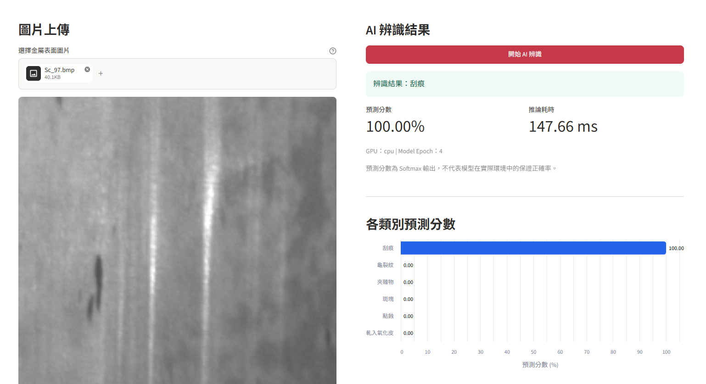
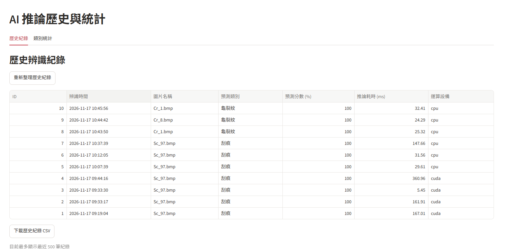
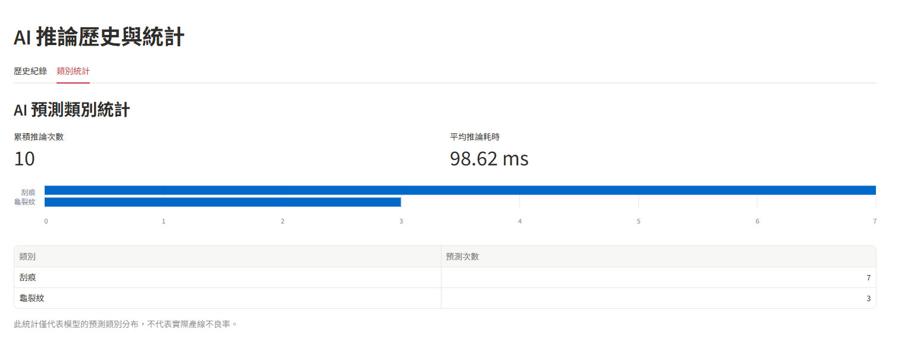
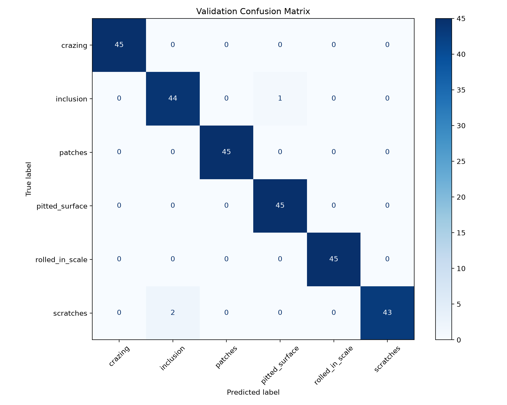

# Industrial Surface Defect Classification System

**End-to-End Deep Learning Project | PyTorch · ResNet18 · FastAPI · Streamlit · SQLite · Docker**

A complete machine learning application for classifying industrial steel surface defects, covering model training, fine-tuning, evaluation, REST API development, database integration, automated testing, and containerized deployment.

## 1. Project Overview

This project implements an AI-based classification system for industrial steel surface defects using a fine-tuned ResNet18 convolutional neural network.

The system accepts uploaded images, predicts one of six defect categories, displays model scores, and saves inference records to an SQLite database.


## Application Demo

### AI Image Classification

Upload a steel surface image to identify one of six defect categories.



### Prediction History

Each inference result is stored in SQLite and can be queried through the dashboard.



### Prediction Statistics

The system provides prediction counts and average inference latency.



> Note: Prediction counts represent model outputs, not actual
> manufacturing defect rates.

## 2. Key Features

- **Deep Learning:** ResNet18 transfer learning and Layer4 fine-tuning
- **Model Evaluation:** Accuracy, Macro F1-score, confusion matrix, and error analysis
- **REST API:** Image classification through FastAPI
- **Web Dashboard:** Interactive image upload and prediction visualization using Streamlit
- **Database:** SQLite prediction history and class statistics
- **Deployment:** Docker Compose with separate API and Dashboard services
- **Testing:** Seven automated API tests using Pytest

## 3. Dataset

**NEU Surface Defect Database (NEU-CLS)**

| Property | Value |
|---|---|
| Total images | 1,800 |
| Categories | 6 |
| Training images | 1,260 |
| Validation images | 270 |
| Test images | 270 |
| Image size | 200 × 200, resized to 224 × 224 |

Classes: Crazing, Inclusion, Patches, Pitted Surface, Rolled-in Scale, and Scratches.

Dataset reference: https://faculty.neu.edu.cn/songkc/en/zdylm/263265/

## 4. Model Evaluation

| Metric | Baseline ResNet18 | Fine-tuned ResNet18 |
|---|---:|---:|
| Test Accuracy | 97.04% | 100.00% |
| Macro F1 | 0.9703 | 1.0000 |
| Incorrect Predictions | 8 | 0 |

Fine-tuning ResNet18 Layer4 and the final classification layer improved the held-out test accuracy by approximately **2.96 percentage points**.



*Important: The 100% result applies only to this 270-image held-out test split. It does not demonstrate production accuracy or cross-domain generalization.*

## 5. System Architecture

```text
                Streamlit Dashboard
                         |
                         | HTTP
                         v
                   FastAPI Backend
                         |
                +--------+--------+
                |                 |
                v                 v
          ResNet18 Model      SQLite Database
          Image Inference    Prediction History
                |            Class Statistics
                v
          JSON Prediction
```

## 6. Technology Stack

| Category | Technologies |
|---|---|
| Language | Python 3.11 |
| Machine Learning | PyTorch, Torchvision |
| Model | ResNet18 |
| API | FastAPI, Uvicorn |
| Frontend | Streamlit, Altair |
| Database | SQLite |
| Deployment | Docker Compose |
| Testing | Pytest, HTTPX |

## 7. Getting Started

### Prerequisites

- Docker Desktop
- Docker Compose
- Fine-tuned model checkpoint

Place the model checkpoint here:

`models/best_resnet18_finetuned.pth`

The model checkpoint is not included in the Git repository.

### Start the Application

```bash
docker compose up -d --build
```

### Access the Services

- Streamlit Dashboard: http://localhost:8501
- FastAPI Documentation: http://localhost:8000/docs

### Stop the Application

```bash
docker compose down
```

SQLite prediction data persists in `data/database/`.

## 8. API Endpoints

| Method | Endpoint | Purpose |
|---|---|---|
| GET | `/health` | Service and model status |
| POST | `/predict` | Image classification |
| GET | `/history` | Prediction history |
| GET | `/statistics` | Class distribution statistics |

## 9. Automated Testing

The project includes seven automated API tests covering normal requests, input validation, prediction history, and database statistics.

**Result:** 7 passed, 1 deprecation warning.

These tests use a mock classifier and an isolated test database; actual model performance is assessed separately.

## 10. Limitations

- The dataset contains six defect classes but no normal-product class.
- The project cannot independently perform validated OK/NG inspection.
- Random dataset splitting may not eliminate similar-image or batch-level leakage.
- Real production conditions, including different lighting and cameras, have not been evaluated.
- The Docker configuration currently uses CPU inference.
- User authentication and production access controls are not implemented.

## 11. Future Work

- Grad-CAM model interpretability
- Additional independent data evaluation
- GPU-accelerated Docker deployment
- Automated inference latency benchmarking
- Model monitoring and drift detection

---

**Project Type:** Personal AI/ML Engineering Portfolio Project